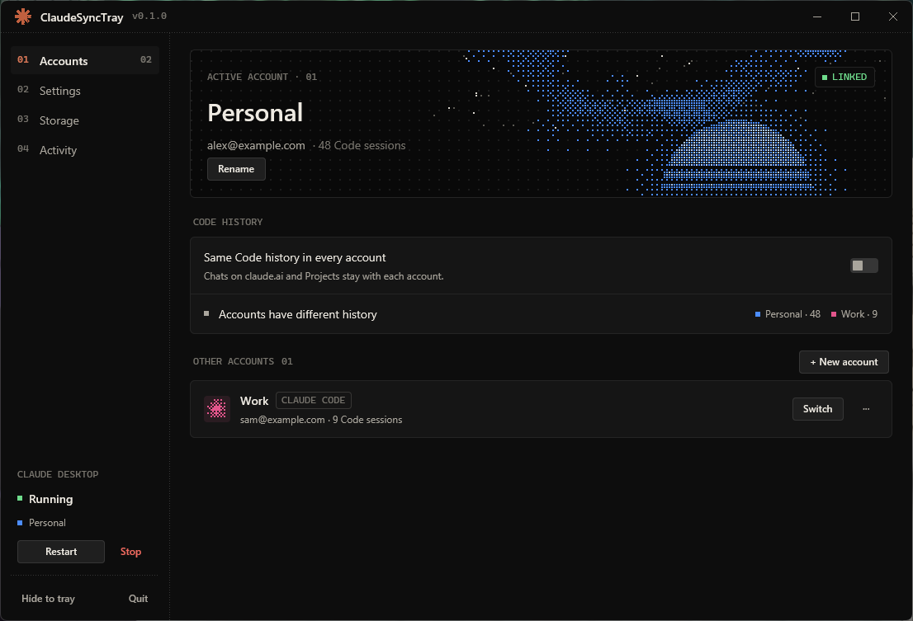
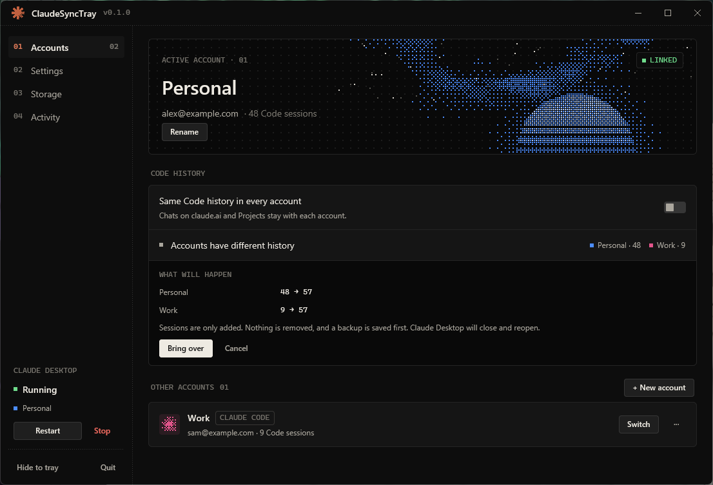
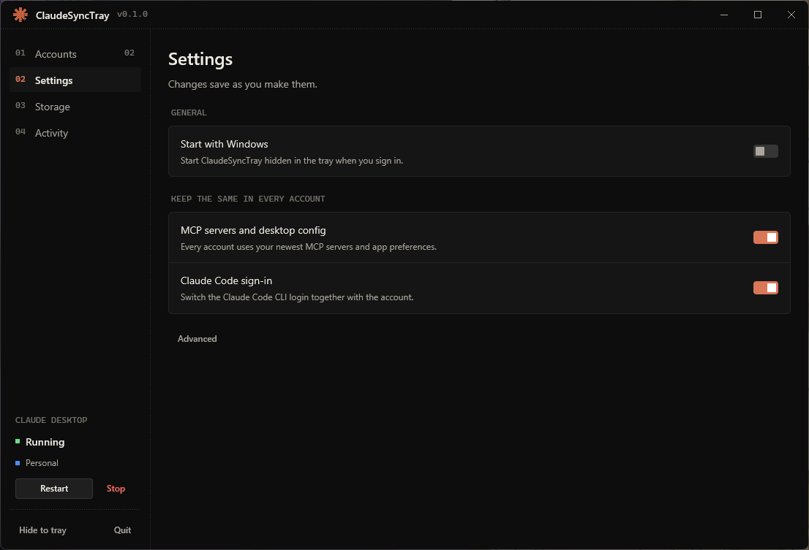
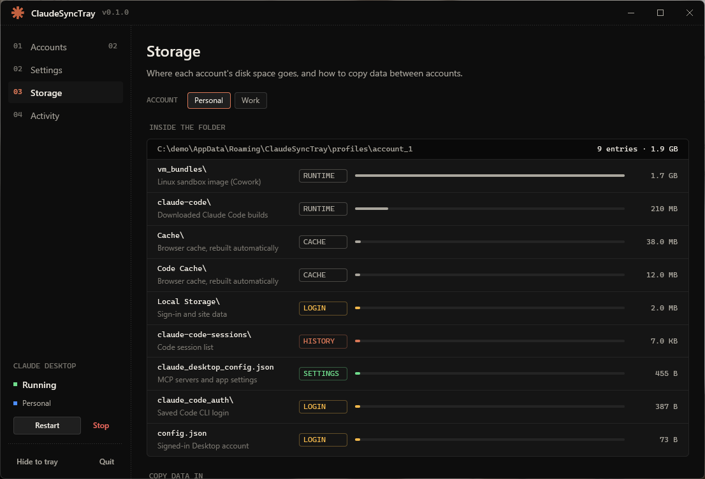

<p align="center"></p>

<h1 align="center">ClaudeSyncTray</h1>

<p align="center">
  Keep several Claude Desktop accounts on one Windows PC, each with its own sign-in and data.<br>
  A small tray app and dashboard that gives every account its own folder and switches between them in a click.
</p>

<p align="center">
  <a href="LICENSE"></a>
  
  
</p>

<p align="center"></p>

> Unofficial. ClaudeSyncTray is an independent project and is not affiliated with or endorsed
> by Anthropic. Windows only (it relies on NTFS junctions).

## Features

- **One click between accounts.** Each account keeps its own sign-in, settings and history. Switching closes Claude Desktop, re-points a folder link and reopens it. No data is copied, so it takes seconds.
- **Dashboard and tray.** Switch from the window or straight from the tray icon. Closing the window hides it to the tray.
- **Same Code history everywhere (optional).** One switch makes the Code tab list the same sessions in every account. It only ever adds, shows what will change first, and backs up before writing.
- **See where the disk space goes.** The Storage page lists what is inside each account folder (the Linux sandbox alone can be 11 GB) and can copy data between accounts, or share one sandbox between them.
- **Keeps what should be shared.** Your MCP servers and the Claude Code CLI sign-in follow the account you switch to.
- **Safe by design.** It never deletes a real folder it did not create, never overwrites sign-in data when copying, and logs everything.

<p align="center">
  
</p>

<p align="center">
  
  
</p>

The screenshots use invented accounts and data. They are generated by
[`tools/screenshots.ps1`](tools/screenshots.ps1).

## Install

There is no installer yet. Build it from source (see [Development](#development)), then run
`target\release\claude-sync-tray.exe`.

You need Windows 10 or 11 and Claude Desktop, either the classic installer or the Microsoft
Store package. Copy the exe somewhere permanent (for example
`%LOCALAPPDATA%\Programs\ClaudeSyncTray\`) before turning on *Start with Windows*, because the
autostart entry stores the exe path.

## Quick start

1. Run `claude-sync-tray.exe`. The dashboard opens and an icon appears in the tray.
2. If the Accounts page says Claude's data folder isn't linked yet, press **Link now**. Your
   current Claude data becomes the first account.
3. Press **+ New account** (or use one of the spare ones), switch to it and sign in to Claude
   Desktop as usual.
4. From then on, press **Switch** on an account, or pick one from the tray menu.

## How it works

Claude Desktop keeps everything (session tokens, cookies, local storage,
`claude_desktop_config.json`) in one data folder. ClaudeSyncTray keeps one real folder per
account and turns Claude's data folder into an NTFS **junction** that points at the active one:

```
%APPDATA%\Claude  ──junction──▶  %APPDATA%\ClaudeSyncTray\profiles\account_1
```

```
%APPDATA%\ClaudeSyncTray\
├── config.json                  # settings (profiles, launch override, autostart)
├── claude-sync-tray.log         # everything is logged here
├── instance.lock                # single-instance guard
├── backups\                     # snapshots taken before anything is changed
├── shared\                      # the one shared Linux sandbox, if you enable that
└── profiles\
    ├── account_1\               # a full, real Claude data directory
    ├── account_2\
    └── account_3\
```

Switching accounts:

1. Closes every Claude **Desktop** process (`WM_CLOSE` to its windows, then a forced stop for
   anything left). The Claude Code CLI is also called `claude.exe`; it is told apart by
   Desktop's Electron `resources` folder and is never touched.
2. Re-points the junction at the chosen profile. Nothing moves.
3. Relaunches Claude Desktop.

Because Claude writes *through* the junction, every session lands in the active profile.

**First run against an existing install.** If `%APPDATA%\Claude` is a normal folder it is
adopted into `profiles\account_1` and replaced with a junction, but only while Claude is not
running. If that profile already holds an account, the stray folder is never merged over it; it
is moved to `backups\stray-claude-data-<timestamp>`.

**Microsoft Store installs** are detected too: the app manages
`%LOCALAPPDATA%\Packages\Claude_*\LocalCache\Roaming\Claude` and launches Claude through its
`shell:AppsFolder` id.

### Sharing Code history between accounts (opt-in)

Desktop's **Code** tab lists sessions from
`claude-code-sessions\<accountId>\<orgId>\local_<id>.json` inside the data folder, so each
account normally sees only its own list. The conversations themselves live in
`~/.claude/projects`, which every account already shares; only these small index files are per
account.

On the **Accounts** page, turn on **Code history ▸ Same Code history in every account**. If the
accounts differ, the app first shows what each one will receive (for example
`Personal  48 → 57`) and asks before anything is copied. It then closes Claude Desktop, backs
up, syncs and reopens it.

- **Sync only adds.** An account with no sessions can never empty one that has many; two
  accounts with different sessions both end up with all of them.
- The newest copy of each session wins. A session deleted in one account (Desktop leaves a
  `deleted_<id>` marker) is removed from all of them and never comes back.
- Account folders that exist in any profile are created in all of them, so signing in to an
  account that has not opened Code yet already shows the shared list.
- It runs on every switch while the switch is on. When new sessions have appeared in one
  account, **Sync now** appears next to the status and does the same close, sync and reopen on
  demand.
- Before anything is written, every profile's session list is copied to
  `backups\auto-sessions-<timestamp>`. The newest 10 are kept; backups you made by hand are
  never pruned. A switch also takes this snapshot when sharing is off. If the snapshot fails,
  nothing is synced.
- Not shared: claude.ai chat history (server-side, per account), Cowork sessions
  (`local-agent-mode-sessions`) and scheduled tasks.

### Copying data between accounts (Storage page)

An account folder holds far more than settings: the Linux sandbox (`vm_bundles`,
`claude-code-vm`) alone is around 11 GB, plus the Claude Code CLI builds and several browser
caches. The **Storage** page lists every top-level folder of the selected account, what it is
for (sign-in, settings, history, sandbox, cache) and its size.

**Copy data in** brings data from another account or a backup folder:

- **Copy minimal** is one click. It copies settings and Code history only, the few MB that are
  yours, and leaves out the sandbox, caches and sign-in data.
- **Customize** shows every folder with what would happen to it before you press anything, and a
  checkbox to include or leave it out. *Minimal* and *Everything* (all but caches) set the
  starting selection.

  | Tag | Meaning |
  |---|---|
  | `COPY` | The account has nothing by that name; it is copied over. |
  | `MERGE` | Both have it. Files the account lacks are added; for Code history, the newer copy of a session wins. |
  | `KEEP` | Already there, left exactly as it is. Sign-in data is never overwritten, so copying cannot change which account someone is logged into. |
  | `SKIP` | Not selected, or a link. |

- **Last copy** lists what each folder received: files added, updated, already there, bytes and
  any file that could not be written. Nothing in the target is deleted.
- Close Claude Desktop first when the active account is involved.

**Linux sandbox ▸ Share** moves each account's sandbox and CLI builds into
`%APPDATA%\ClaudeSyncTray\shared` once and links every account to it with a junction, so the
11 GB exists a single time. **Undo** removes the links and moves the folder back. A second real
copy is never deleted, only reported. Don't run two accounts side by side while the sandbox is
shared.

## Usage

**Dashboard pages**

- **Accounts:** switch, add, rename or remove accounts, see each one's email and Code session
  count, and keep the Code history the same everywhere with one switch.
- **Settings:** *Start with Windows* and what to keep the same in every account. Under
  **Advanced**: manual sync buttons, `claude.exe` and launch overrides, and folder shortcuts.
- **Storage:** what each account folder contains and how big it is, copying between accounts,
  and sharing one Linux sandbox.
- **Activity:** `claude-sync-tray.log`, live.

**Tray menu** (left-click toggles the dashboard, right-click opens the menu)

| Menu item | Action |
| --- | --- |
| **Open Dashboard** | Show and focus the window |
| **Active: Account N** | Current account (status only) |
| **Switch Account ▸** | Switch to any configured account |
| **Restart Claude Desktop** | Relaunch on the current account |
| **Repair Profile Link** | Re-create the junction if it was tampered with |
| **Start with Windows** | Toggle the `HKCU\...\CurrentVersion\Run` entry (starts hidden with `--tray`) |
| **Open Claude Code Projects** | Opens `%USERPROFILE%\.claude\projects` |
| **Open Profiles Folder** | Opens the profile store |
| **Open Log File** | Opens the log |
| **Quit** | Exit the dashboard and tray |

### Command line

```
claude-sync-tray                 # open dashboard & tray (or focus existing instance)
claude-sync-tray --tray          # start hidden in the system tray
claude-sync-tray --switch 2      # switch to the 2nd profile (numbering starts at 1) and exit
claude-sync-tray --help
```

If the tray is already running, `--switch N` is handed to it through
`%APPDATA%\ClaudeSyncTray\command.txt` and runs within a second, which makes it easy to bind a
keyboard shortcut to an account.

## Configuration

`%APPDATA%\ClaudeSyncTray\config.json`:

```json
{
  "version": 1,
  "active": 0,
  "profiles": [
    { "name": "Account 1", "dir": "profiles/account_1" },
    { "name": "Account 2", "dir": "profiles/account_2" },
    { "name": "Account 3", "dir": "profiles/account_3" }
  ],
  "live_override": null,
  "launch": null,
  "start_with_windows": false,
  "share_mcp_config": true,
  "sync_claude_code": true,
  "share_sessions": false
}
```

| Field | Purpose |
| --- | --- |
| `profiles` | Rename accounts or add more. `dir` may be absolute or relative to `%APPDATA%\ClaudeSyncTray`. |
| `live_override` | Force the Claude data directory (for example a portable install). |
| `launch.exe` | Explicit `claude.exe` path; skips auto-detection. |
| `launch.command` | Arbitrary launch command (for example a `shell:AppsFolder` id). |
| `active` | Fallback only. The junction target wins on startup. |
| `share_mcp_config` | Keep `claude_desktop_config.json` (MCP servers, app settings) identical across profiles. |
| `sync_claude_code` | Swap the Claude Code CLI credentials together with the Desktop account. |
| `share_sessions` | Mirror the Code session list into every account. Off by default. |

`claude.exe` is auto-detected from the running process, `%LOCALAPPDATA%\AnthropicClaude\app-*`,
`%LOCALAPPDATA%\Programs\Claude`, `%ProgramFiles%\Claude` and the `App Paths\claude.exe`
registry key.

## Reliability notes

- **File locks:** Claude's Electron app keeps session `.json` files open while writing. Every
  filesystem operation retries with backoff on `ERROR_ACCESS_DENIED`, `SHARING_VIOLATION` and
  `LOCK_VIOLATION`, so a switch during a write normally still succeeds.
- **Safety:** the app never recursively deletes a *real* directory it did not create; an
  unmanaged directory is adopted (moved) first. A junction is only removed, never followed.
- **Single instance:** enforced with an exclusive lock on `instance.lock`.

### Caveats

- The live path is a junction owned by this tool. **Don't delete `%APPDATA%\ClaudeSyncTray`
  while Claude is installed**, as that leaves a dangling junction. To uninstall cleanly, *Quit*
  the tray, treat one profile directory as authoritative, copy it back to `%APPDATA%\Claude`
  and remove the junction (`rmdir "%APPDATA%\Claude"`, then move the real folder in).
- Some "cleaner" and antivirus tools flag junctions. If Claude misbehaves after a cleanup, use
  **Repair Profile Link**.
- A switch blocks the event loop for a few seconds while Claude shuts down.

## Troubleshooting

Check `%APPDATA%\ClaudeSyncTray\claude-sync-tray.log` first (or the Activity page). Common
cases:

- *"Claude Desktop still has files open"*: quit Claude from its own UI and retry.
- Claude won't launch: set `launch.exe` in `config.json` to the real path.
- Store install: set `launch.command` to
  `explorer.exe shell:AppsFolder\<PackageFamilyName>!<AppId>` if auto-detection fails.

## Development

Requirements: Windows 10/11, Rust 1.89 or newer, and the Visual Studio Build Tools with the
**Desktop development with C++** workload and a Windows SDK (GPUI links against the MSVC
toolchain).

```powershell
cargo build --release     # -> target\release\claude-sync-tray.exe
cargo test                # unit tests (sessions, transfers, profiles, paths)
```

If `cargo` fails with a linker error, run it from a *x64 Native Tools Command Prompt*: Git's own
`link.exe` can shadow the MSVC one.

While developing, `powershell -File tools\dev.ps1` rebuilds in place even when the tray is
running (Windows can rename a running exe but not overwrite it) and restarts it. Add `-NoRun` to
only build.

To regenerate the screenshots after a UI change, build, then run
`powershell -File tools\screenshots.ps1`. It starts the app against a throwaway demo tree under
`C:\demo` (the app reads `%APPDATA%`, `%LOCALAPPDATA%` and `%USERPROFILE%`, so none of your
real data is touched or shown) and writes `docs/screenshots/*.png`. It needs a visible desktop.

### Logo and icons

`logo-dithered.jpg` is the brand artwork. Three things are derived from it:

| Where | How |
|---|---|
| Dashboard title bar | Drawn procedurally from the logo's geometry (`src/logo.rs`) and dithered with an 8x8 Bayer matrix (`src/dither.rs`); no image is shipped for it. |
| Tray icon | The asterisk on a dark tile, rasterised at the shell's small-icon size, with a pip in the active account's colour (`src/icon.rs`). |
| `.exe` / taskbar / window icon | `assets/icon.ico`, embedded by `build.rs`. Regenerate it from the JPG with `python tools/make_icon.py` (needs Pillow). If no Windows resource compiler is available the build still succeeds, just without the embedded icon. |

## Contributing

Bug reports, ideas and pull requests are welcome. Please read [CONTRIBUTING.md](CONTRIBUTING.md)
first and follow the [Code of Conduct](CODE_OF_CONDUCT.md). To report a security problem, see
[SECURITY.md](SECURITY.md); please don't open a public issue for it.

## License

[MIT](LICENSE)
